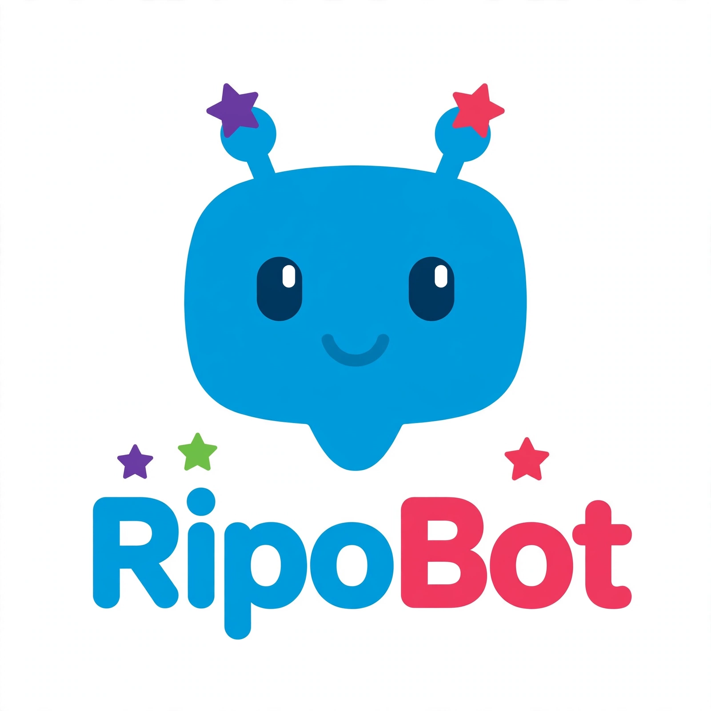

<div align="center">



# RipoBot

**Your own team of AI bots, in a chat app.**

Every bot in the sidebar is a real agent with its own personality, model, tools, and connected apps.
Talk to them like contacts. Watch them work. Approve what matters.


</div>

---

> ⚠️ **No affiliation with any cryptocurrency.** RipoBot has no token. Any coin using the RipoBot or Ripo name is not created, endorsed, or affiliated with this project or its maintainer.

## What it is

RipoBot is a local-first chat app for running a team of AI agents — built by **Ripo Team** as a fork of [OpenMausBot](https://github.com/milind-soni/OpenMausBot) by Milind Soni (Apache 2.0, see [NOTICE](NOTICE)). It ships as a web UI, a Node harness server, and an Electron desktop app for macOS, Windows, and Ubuntu.

Each bot is a full agent loop: it can chat, run tools, use MCP servers, browse with its own bundled browser, operate a computer (CUA), run on a schedule, and talk to you from a phone companion app. Bots keep their own files, memory, and connected accounts.

## Models: bring your own, or go keyless

RipoBot ships a built-in **OpenAI-compatible driver** — point it at any OpenAI-style endpoint with `OPENAI_COMPAT_URL` (plus `OPENAI_COMPAT_MODEL` / `OPENAI_COMPAT_API_KEY` when the endpoint needs them).

No API keys? Point it at a free keyless endpoint instead — e.g. Pollinations' keyless OpenAI-compatible API (`https://text.pollinations.ai/openai`) — and you're chatting without signing up for anything. (Pollinations' `https://gen.pollinations.ai/v1` looks similar but requires an API key.) Provider CLIs (Claude, Codex, …) also work as engines when you have them installed and authenticated.

## Quick start

Prerequisites: **Node.js ≥ 24**, **pnpm 10**.

```bash
pnpm install

# Web UI (Vite dev server)
pnpm dev

# Headless harness server / CLI
pnpm ripo
```

Useful scripts:

| Command | What it does |
|---|---|
| `pnpm dev` | Web UI dev server |
| `pnpm dev:server` | Harness server dev |
| `pnpm ripo` | Run the `ripobot.ts` CLI (server) |
| `pnpm pair` | Pair a device (`ripobot.ts pair`) |
| `pnpm typecheck` / `pnpm lint` | Typecheck / lint |
| `pnpm test` | Full test suite |

### Desktop app (Electron)

```bash
pnpm package:win    # → release/RipoBot-<version>-setup.exe
pnpm package:mac    # → release/RipoBot-<version>-<arch>.dmg
pnpm package:linux  # → AppImage / .deb
```

Releases also ship a stable `RipoBot-setup.exe` download name. The Windows installer is unsigned, so SmartScreen shows "unknown publisher" on first run. In-app auto-update reads `latest.yml` from the GitHub releases of this repo — upload it alongside the artifacts.

### Docker / self-host

```bash
# Windows
.\ripo.ps1 up -d
# macOS / Linux
docker compose up -d
```

See [`compose.yaml`](compose.yaml) and [`deploy/`](deploy/) for the VPS and local setups.

## Project layout

| Path | What it is |
|---|---|
| `src/` | React + Vite web UI |
| `server/` | Node harness (agents, tools, drivers, webhooks) |
| `electron/` | Electron main/preload, updater, tray |
| `companion/` | Companion sidecar (phone apps talk to this) |
| `apps/docs/` | Documentation site source |
| `skills/` | Bundled agent skills |
| `assets/` | RipoBot brand assets (logo, icon, mascot) |

Brand sources live in `assets-src/`; generated deliverables (`.ico`/`.icns`/favicons) are built from `assets/ripobot-icon-1024.png`.

## Configuration

Copy `.env.example` to `.env`. The knobs that matter most:

- `RIPO_HTTP_PORT` / `RIPO_BIND_ADDRESS` — where the server listens
- `OPENAI_COMPAT_URL` — any OpenAI-compatible endpoint (keyless options work)
- `ANTHROPIC_API_KEY`, `OPENAI_API_KEY`, … — provider keys, if you use those engines

## License & attribution

Apache 2.0 — see [LICENSE](LICENSE). This is a fork of OpenMausBot, copyright 2026 Milind Soni and OpenMausBot contributors; the original attribution is preserved in [NOTICE](NOTICE). Third-party licenses ship under `licenses/` in desktop builds and in `third_party/`.
